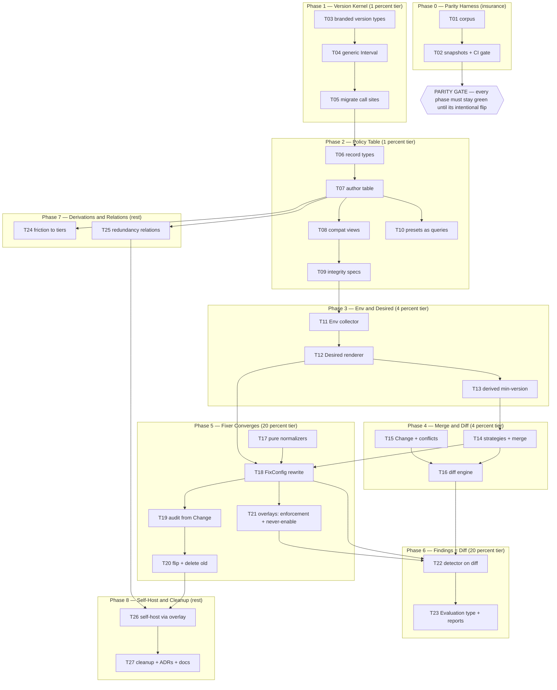

# SUPERB Plan — The Declarative Reconciler

**Date:** 2026-10-13 17:45 · **Status:** PROPOSED (awaiting execution)
**Source:** Architecture deep-dive session (declarative redesign of policy data model + fixer engine)
**Scope:** `pkg/types`, `pkg/constants`, `pkg/linter`, `pkg/finding`, `pkg/config`, `pkg/policy`, `internal/cli`, docs

---

## 1. Vision

This tool is **already a desired-state reconciler wearing an imperative mutator's costume**.
The audit ledger is reconciliation history, the sidecar is declared divergence, dry-run is
`plan`, presets are profiles — but the engine is ~600 lines of `if empty then set` mutation
passes with hand-rolled counters, guarded by data-integrity tests that exist only because the
type system cannot express "one linter, one tier".

**Target:** `Render → Normalize → Diff → Converge`.

```
CollectEnv() (Env, error)          -- I/O edge, classified errors
Normalize(observed)  observed'     -- pure (rescue run.go, bad-key renames)
Desired(policy, env) Config        -- pure rendering of the policy table
Merge(observed', desired, strat)   -- pure, strategies are DATA
Diff(observed', merged) []Change   -- pure, stable path keys
Save(cfg) error                    -- I/O edge
```

- **Findings ARE the diff**: detector and fixer become one evaluation engine with two drivers
  (lint mode / apply mode). Detect-repair drift (`WithPriority`) becomes impossible.
- **Idempotency by construction**: a converged config re-converges to itself. Recorder,
  counters, `counts.total()==0` guard, dry-run early-returns all die.
- **Every fact in one place**: 7+ parallel linter maps become one policy table; deprecation
  becomes a version-interval bound; `MinGolangCILintVersion` DERIVES from rendered settings.
- **Two version axes, branded types**: `GolangciVersion` (tool semver) vs `GoVersion`
  (major.minor). One generic `Interval[V]`; cross-axis comparison is a compile error.

## 2. Non-Negotiable Principles (Verschlimmbesserung Insurance)

1. **Phase 0 before everything**: snapshot today's exact behavior (config bytes + findings +
   audit entries) across a corpus of real configs. Every later phase must keep the parity gate
   green until its intentional flip.
2. **No behavior change without a flip**: new engine runs behind a flag/beside the old path
   until corpus-parity is proven; then the old path is deleted in the same PR series.
3. **Compile-time beats test-time**: every deleted data-integrity test must be deleted
   *because* the invariant became a type-level fact — verified by intentionally breaking it.
4. **160 sibling projects depend on output stability.** Byte-level drift in generated configs
   is a regression unless the plan says otherwise.
5. **GOEXPERIMENT=jsonv2 + CGO_ENABLED=1** for tests; run `ginkgo -r -p -race` per phase.

## 3. Target Data Model (final state from the design session)

```go
type GolangciVersion struct{ /* semver, Parse-only construction, canonical String */ }
type GoVersion     struct{ maj, min int }               // patch forbidden
type Ordered[T any] interface{ Compare(T) int }
type Interval[V Ordered[V]] struct{ Min, Max V }        // zero = unbounded

type Evidence struct{ Nolints, Configs int; Ratio float64; AsOf time.Time }

type LinterPolicy struct {
    Name         types.LinterName
    ValidTool    Interval[GolangciVersion] // deprecation = Max bound
    Lang         Interval[GoVersion]       // linguistic relevance (zero = always)
    SupersededBy types.LinterName          // zero = none; unifies DeprecatedLinters
    Priority     LinterPriority
    Rationale    string                    // the ONE reason the table owns (per-decision
                                           // reasons live on tier/gate/supersession payloads)
    Friction     *Evidence                 // measured; tiers DERIVE from this
    Settings     []VersionedSettings       // each carries ValidTool → min-version derives
    Tier         Tier                      // closed union w/ Rationale payloads
    Gate         Gate                      // RequiresTech | RecommendAlways (relations move out)
}

type Env struct {
    Tool        GolangciVersion // detected binary
    ToolBuildGo GoVersion       // Go the binary was built with (run.go cap)
    LocalGo     GoVersion       // toolchain
    ProjectGo   GoVersion       // go.mod directive
}
```

Policy (curated, ours) stays separate from metadata (discovered, golangci-lint's:
`Fast`, `AutoFix`, `Description`) — joined on name at evaluation time, never stored together.

## 4. Pareto Analysis

| Tier | What | Why it is THE leverage |
|---|---|---|
| **1% → 51%** | **Policy Kernel**: branded version types + generic `Interval[V]` + ONE policy table | Every later subsystem is a function over this table. Kills all map split-brains; adding a linter drops from 5+ files to 1 entry; deprecation handling becomes diff data. |
| **4% → 64%** | **Pure Core**: `Env` collector + `Desired()` renderer + merge-strategy table + diff engine | Makes idempotency, dry-run, `--force-settings`, and conflict detection structural. Deletes gotcha #6 machinery before the fixer is even touched. |
| **20% → 80%** | **Convergence**: fixer rewritten as converge; findings = diff; detector unified | Customer-visible: plan/apply consistency across 160 projects, reliable audit entries, detect-repair loops structurally gone. |
| **Other 20% → 100%** | Derivations (min-version, tiers-from-friction, presets-as-queries), redundancy relations, self-hosting (kills self-config trap), `ConfigAnalysis` slim-down, docs/ADRs, cleanup | Long-term health; each removes a hand-synced constant or a documented trap. |

## 5. Comprehensive Plan — Medium Granularity (30–100 min per task, 27 tasks)

Sorted by Pareto tier (importance), execution order shown in `#` column (dependency-driven).

| # | ID | Task | Phase | Tier | Impact | Effort | Customer value |
|---|---|---|---|---|---|---|---|
| 1 | T01 | Assemble parity corpus of real-world configs | P0 Safety | gate | ★★★★★ | 45m | Insurance for all 160 consumer projects |
| 2 | T02 | Snapshot current outputs (config bytes, findings, audit) + CI parity gate | P0 Safety | gate | ★★★★★ | 75m | Regression detection at byte level |
| 3 | T03 | `GolangciVersion` + `GoVersion` branded types (absorb `version_type.go`) | P1 Kernel | 1% | ★★★★★ | 100m | Ends two-version-system split brain |
| 4 | T04 | Generic `Interval[V Ordered[V]]` + unbounded-zero specs | P1 Kernel | 1% | ★★★★☆ | 40m | Cross-axis misuse becomes compile error |
| 5 | T05 | Migrate all version call sites behind the types | P1 Kernel | 1% | ★★★★☆ | 90m | Single comparison mechanism |
| 6 | T06 | Policy record types: tier union, gates, `VersionedSettings`, supersession, `Evidence` | P2 Table | 1% | ★★★★★ | 90m | Invariants move to compile time |
| 7 | T07 | Author the policy table (mechanical migration of all 7+ maps) | P2 Table | 1% | ★★★★★ | 100m | One fact, one place |
| 8 | T08 | Compat views (generate legacy maps) + views-parity spec | P2 Table | 1% | ★★★☆☆ | 60m | Zero-risk switchover for consumers |
| 9 | T09 | Port integrity specs + `scripts/validate_linter_data.go` to table; delete now-compile-time tests | P2 Table | 1% | ★★★☆☆ | 60m | Less test debt |
| 10 | T10 | Presets as queries over the table + parity vs hardcoded lists | P2 Table | rest | ★★★☆☆ | 60m | `reference` can never drift again |
| 11 | T11 | `Env` struct + collector with classified errors | P3 Desired | 4% | ★★★★☆ | 60m | All env facts named, one boundary |
| 12 | T12 | `Desired(policy, env) → Config` renderer | P3 Desired | 4% | ★★★★★ | 100m | The pure heart of the reconciler |
| 13 | T13 | DERIVE `MinGolangCILintVersion` from rendered `VersionedSettings`; pin-matrix green | P3 Desired | 4% | ★★★★☆ | 60m | Kills gotcha #28 hand-sync |
| 14 | T14 | Merge strategy table (EnsurePresent/Union/PreferUser/Cap/PreferDesired) + merge engine + idempotency specs | P4 Merge/Diff | 4% | ★★★★★ | 100m | `--force-settings` becomes a strategy flip |
| 15 | T15 | `Change` type with stable path keys + conflict detection | P4 Merge/Diff | 4% | ★★★★☆ | 40m | No more silent last-writer-wins |
| 16 | T16 | Diff engine + parity vs old counters on corpus | P4 Merge/Diff | 4% | ★★★★★ | 100m | Plan/apply consistency |
| 17 | T17 | Normalizers as pure functions (run.go rescue, bad-key renames) | P5 Converge | 20% | ★★★☆☆ | 35m | Counting disappears (diff does it) |
| 18 | T18 | Rewrite `FixConfig` as collect→normalize→render→merge→diff→save (behind flag) | P5 Converge | 20% | ★★★★★ | 100m | Deletion of recorder/counters/dry-run branches |
| 19 | T19 | Audit emission from `Change` records; delete `configChangeRecorder` | P5 Converge | 20% | ★★★★☆ | 40m | Audit = diff, always truthful |
| 20 | T20 | Flip engine for all corpora; delete old imperative path | P5 Converge | 20% | ★★★★★ | 60m | The actual cutover |
| 21 | T21 | Sidecar `never-enable` + anti-gaming enforcement as merge overlays | P5 Converge | 20% | ★★★★☆ | 90m | Regression-loop detection becomes unnecessary |
| 22 | T22 | Findings = diff: `Deviation` adapter, detector rewrite, delete `WithPriority` | P6 Findings | 20% | ★★★★★ | 90m | Detect/repair drift structurally dead |
| 23 | T23 | `ConfigAnalysis` slim-down (counts→methods), `Evaluation` type, golden regen | P6 Findings | rest | ★★★☆☆ | 90m | One report input type |
| 24 | T24 | Friction `Evidence` data + tier DERIVATION + `--pragmatic` as threshold | P7 Derive | rest | ★★★☆☆ | 90m | Tiers from measurements, not opinions |
| 25 | T25 | Redundancy as typed relation table + referential integrity specs | P7 Derive | rest | ★★★☆☆ | 60m | Relations can't dangle |
| 26 | T26 | Self-host: sidecar as divergence overlay; own config = render ⊕ divergences | P8 Self-host | rest | ★★★★☆ | 100m | Kills the self-config trap |
| 27 | T27 | Cleanup + docs: delete shims, ADRs, rewrite AGENTS.md gotchas #2/#6/#28 | P8 Cleanup | rest | ★★★☆☆ | 100m | Docs stop lying |

**Total: ~27 tasks, ≈ 2,120 min ≈ 35.5 h** (excl. review wait-times).

## 6. Fine Breakdown — Micro Tasks (≤ 12 min each, ALL todos)

| ID | Micro-task | Est | Deps |
|---|---|---|---|
| T01.1 | Inventory fixture sources (own `.golangci.yml`, schema-fixture, loader tests, 5–10 sanitized sibling configs) | 10 | — |
| T01.2 | Create `testdata/parity-corpus/`; copy configs | 12 | T01.1 |
| T01.3 | Per-fixture manifest (env assumptions: tool version, Go version, tech flags) | 8 | T01.2 |
| T01.4 | Corpus loader helper (Go: list config+env pairs) | 12 | T01.3 |
| T02.1 | Snapshot runner: run `configure` per fixture, capture resulting config bytes | 12 | T01.4 |
| T02.2 | Capture findings + audit entries per fixture | 12 | T02.1 |
| T02.3 | Commit corpus goldens | 5 | T02.2 |
| T02.4 | Parity script (regen + `diff` + non-zero exit on drift) | 12 | T02.3 |
| T02.5 | CI parity job on PRs | 10 | T02.4 |
| T03.1 | `GolangciVersion` struct + `Parse` (canonical `vX.Y.Z`) | 12 | — |
| T03.2 | Canonical `String` + validation specs | 10 | T03.1 |
| T03.3 | `Compare` + ordering specs | 10 | T03.2 |
| T03.4 | Fuzz spec port from `version_fuzz_test.go` | 10 | T03.3 |
| T03.5 | `GoVersion` struct (major.minor only) + `Parse` | 12 | — |
| T03.6 | Absorb `NormalizeGoMajorMinor`/`CompareGoMajorMinor` semantics + specs | 12 | T03.5 |
| T03.7 | Deprecation shims forwarding old helpers to new types | 8 | T03.6 |
| T04.1 | `Ordered[T]` self-referential constraint | 10 | T03.* |
| T04.2 | `Interval[V]` + `Contains` | 12 | T04.1 |
| T04.3 | Zero-value = unbounded semantics specs | 10 | T04.2 |
| T04.4 | Parse/Format round-trip specs | 10 | T04.3 |
| T05.1 | `categorizer` `LinterMinVersions` → `GolangciVersion` | 12 | T04.* |
| T05.2 | `version_checker` + analyzer wiring on typed versions | 12 | T05.1 |
| T05.3 | `run.go` cap path (`updateGoVersion`) → `GoVersion` | 12 | T05.2 |
| T05.4 | `GoExperiment.GraduatedIn` → `GoVersion` | 10 | T05.3 |
| T05.5 | `LinterReplacement.MinVersion` → `Interval[GolangciVersion]` | 12 | T05.4 |
| T05.6 | Full suite + parity run green | 10 | T05.5 |
| T06.1 | `LinterPolicy` struct + field-by-field doc comments | 12 | T05.6 |
| T06.2 | Closed `Tier` union (4 payloads, each with `Rationale`) | 12 | T06.1 |
| T06.3 | `Gate` payloads: `RequiresTech` vs `RecommendAlways` | 12 | T06.2 |
| T06.4 | `VersionedSettings` + `Evidence` structs | 12 | T06.3 |
| T06.5 | `SupersededBy` + `ValidTool`/`Lang` intervals on record | 10 | T06.4 |
| T07.1 | Migrate `LinterPriorities` | 12 | T06.5 |
| T07.2 | Migrate `LinterReasons` | 10 | T07.1 |
| T07.3 | Migrate `DisabledLinters`/`NeverAutoEnable`/`PragmaticNoise` tiers (reasons verbatim) | 12 | T07.2 |
| T07.4 | Migrate `DeprecatedLinters` → `ValidTool` Max-bound + `SupersededBy` | 12 | T07.3 |
| T07.5 | Migrate `LinterMinVersions` + `ProjectSpecificLinters` gates | 12 | T07.4 |
| T07.6 | Migrate `DefaultLinterSettings` → `VersionedSettings` (since-versions researched) | 12 | T07.5 |
| T07.7 | Migrate formatter policy (order, core, redundancy) into parallel `FormatterPolicy` table | 12 | T07.6 |
| T07.8 | Table compiles; gap-fix pass | 10 | T07.7 |
| T08.1 | View functions generating legacy maps from the table | 12 | T07.8 |
| T08.2 | Swap package-level map vars to view calls (compile-only change) | 12 | T08.1 |
| T08.3 | Parity spec: views deep-equal the old literals | 12 | T08.2 |
| T09.1 | Port tier-disjointness specs to the table | 12 | T08.3 |
| T09.2 | Delete now-compile-time data-integrity tests (verify by intentionally breaking) | 10 | T09.1 |
| T09.3 | Port `scripts/validate_linter_data.go` to the table | 12 | T09.2 |
| T09.4 | Re-point FEATURES deprecation-map spec at the table | 10 | T09.3 |
| T10.1 | `PresetQuery` type (by tier/priority/lang/validity) | 12 | T09.4 |
| T10.2 | Derive `PresetLinters`/`PresetFormatters` from queries | 12 | T10.1 |
| T10.3 | Parity spec: derived lists == old hardcoded lists | 12 | T10.2 |
| T10.4 | Derive descriptions/counts | 8 | T10.3 |
| T11.1 | `Env` struct (`Tool`, `ToolBuildGo`, `LocalGo`, `ProjectGo`, tech set, gen-scan) | 12 | T10.4 |
| T11.2 | Collector: golangci-lint version + build-Go | 12 | T11.1 |
| T11.3 | Collector: go.mod directive + toolchain Go | 10 | T11.2 |
| T11.4 | Collector: technologies + gogenfilter results | 12 | T11.3 |
| T11.5 | Classified errors at collector boundary | 10 | T11.4 |
| T12.1 | Render `linters.enable` from policy + env | 12 | T11.5 |
| T12.2 | Render formatters section | 10 | T12.1 |
| T12.3 | Render settings with interval filtering | 12 | T12.2 |
| T12.4 | Render exclusions (default paths/rules + scan results) | 12 | T12.3 |
| T12.5 | Render run/issues/output defaults | 12 | T12.4 |
| T12.6 | `Desired()` composition + golden render spec | 12 | T12.5 |
| T13.1 | Derive min-version = min over rendered `VersionedSettings.Min` | 12 | T12.6 |
| T13.2 | Replace hand constant with derivation (+ deprecation alias) | 12 | T13.1 |
| T13.3 | `generate-settings -min-tool-version` sync check | 10 | T13.2 |
| T13.4 | Pin matrix run green (`scripts/e2e-pin-matrix.sh`) | 10 | T13.3 |
| T14.1 | Strategy enum + registry skeleton | 12 | T13.4 |
| T14.2 | Author per-path strategy table | 12 | T14.1 |
| T14.3 | Merge engine core (top-level sections) | 12 | T14.2 |
| T14.4 | Merge nested sections: settings | 12 | T14.3 |
| T14.5 | Merge nested sections: exclusions (RuleKey union) | 12 | T14.4 |
| T14.6 | Idempotency property spec: `merge(merge(x)) == merge(x)` | 12 | T14.5 |
| T14.7 | `--force-settings` = `PreferUser`→`PreferDesired` flip spec | 12 | T14.6 |
| T15.1 | `Change` struct + stable path key | 12 | T14.7 |
| T15.2 | Conflict detection (two writers, same key → classified error) | 12 | T15.1 |
| T15.3 | Specs incl. conflict-error classification | 10 | T15.2 |
| T16.1 | Diff engine: scalar fields | 12 | T15.3 |
| T16.2 | Diff: lists (enable/disable/paths) as set ops | 12 | T16.1 |
| T16.3 | Diff: settings maps incl. key renames | 12 | T16.2 |
| T16.4 | Parity spec vs old counters on corpus | 12 | T16.3 |
| T17.1 | `rescueOverspecifiedRunGo` → pure normalizer | 12 | T16.4 |
| T17.2 | `KnownBadSettingsKeys` rename → pure normalizer | 12 | T17.1 |
| T17.3 | Normalizer ordering + spec | 8 | T17.2 |
| T18.1 | `FixConfig` skeleton: collect→normalize→render→merge→diff (flag-gated) | 12 | T17.3 |
| T18.2 | Save path + classified error mapping | 12 | T18.1 |
| T18.3 | Dry-run = report diff, no write | 12 | T18.2 |
| T18.4 | `--check` exit semantics preserved | 12 | T18.3 |
| T18.5 | `MigrationResult` field parity | 12 | T18.4 |
| T18.6 | Corpus run behind flag, compare vs snapshots | 12 | T18.5 |
| T19.1 | `Change`→audit-entry adapter (all existing action types) | 12 | T18.6 |
| T19.2 | Delete `configChangeRecorder` + `counts.total()==0` guard | 10 | T19.1 |
| T19.3 | Ledger specs parity | 12 | T19.2 |
| T20.1 | Flip default to converge engine; corpus byte-green | 12 | T19.3 |
| T20.2 | Delete old imperative path (`applyAllFixes`/`applyAndSave`) | 12 | T20.1 |
| T20.3 | Update integration specs | 12 | T20.2 |
| T21.1 | Sidecar policy → merge overlay strategies | 12 | T20.3 |
| T21.2 | `never-enable` as overlay + parity specs | 12 | T21.1 |
| T21.3 | Anti-gaming re-enable through overlay | 12 | T21.2 |
| T21.4 | Remove ledger cycle-detection heuristic; update docs | 10 | T21.3 |
| T22.1 | `Deviation` adapter (`Change`→`finding.Finding`) | 12 | T21.4 |
| T22.2 | Lint-mode driver (report-only) | 12 | T22.1 |
| T22.3 | Detector rewrite on diff | 12 | T22.2 |
| T22.4 | Delete `WithPriority` + loop-prevention machinery | 8 | T22.3 |
| T22.5 | Findings parity spec vs old detector output | 12 | T22.4 |
| T23.1 | `ConfigAnalysis` counts → derived methods | 10 | T22.5 |
| T23.2 | `Evaluation` type (`Env`/`Desired`/`Observed`/`Deviations`) | 12 | T23.1 |
| T23.3 | Report generators port: templ | 12 | T23.2 |
| T23.4 | Report generators port: json/sarif | 12 | T23.3 |
| T23.5 | `UPDATE_GOLDEN=1` regen + diff review | 8 | T23.4 |
| T24.1 | `Evidence` struct + AsOf sourcing | 12 | T23.5 |
| T24.2 | Encode measured friction ratios (6.5/5.1/1.8/1.3/0.83) as data | 12 | T24.1 |
| T24.3 | Tier derivation fn + threshold constant | 12 | T24.2 |
| T24.4 | `--pragmatic` as threshold parameter + parity spec | 12 | T24.3 |
| T24.5 | Delete hand-maintained tier maps | 10 | T24.4 |
| T25.1 | Redundancy relation types with typed keys | 12 | T24.5 |
| T25.2 | Referential integrity specs (targets must exist) | 10 | T25.1 |
| T25.3 | Port categorizer/formatter redundancy checks | 12 | T25.2 |
| T26.1 | Sidecar format = divergence overlay | 12 | T25.3 |
| T26.2 | Overlay application in converge path | 12 | T26.1 |
| T26.3 | Render own `.golangci.yml`; document divergences in sidecar | 12 | T26.2 |
| T26.4 | Self-verify: re-run = zero diff (self-config trap dead) | 10 | T26.3 |
| T27.1 | Delete compat views + legacy map vars | 12 | T26.4 |
| T27.2 | Delete dead tests/helpers | 10 | T27.1 |
| T27.3 | ADR: reconciler architecture decision | 12 | T27.2 |
| T27.4 | ADR: two version axes | 10 | T27.3 |
| T27.5 | AGENTS.md gotcha rewrites (#2, #6, #28) | 12 | T27.4 |
| T27.6 | FEATURES / TODO_LIST / CHANGELOG updates | 12 | T27.5 |

**Total: 127 micro-tasks.**

## 7. Execution Graph



## 8. Verification and Rollback (per phase)

| Phase | Gate | Rollback |
|---|---|---|
| P0 | Corpus snapshots committed; parity script green trivially | Delete nothing — additive only |
| P1–P2 | Full test suite + parity corpus byte-identical + views-parity spec | Revert to map literals (compat views make this a var swap) |
| P3–P4 | Renderer goldens; idempotency property specs; pin matrix green | New code is additive; flag off |
| P5 | Corpus byte-green behind flag → flip → delete; audit-ledger entry parity | Flag flip back; old path still present until T20.2 |
| P6 | Findings parity vs old detector on corpus | Detector rewrite is additive until swap |
| P7–P8 | Parity specs for derived tiers/presets; zero-diff self-verify | Derived vs stored comparisons make drift visible in tests |

## 9. Deliberately NOT Doing

- **No CUE / external policy files** — compile-time safety on curated values beats serializability.
- **No key-level merge surgery** — strategies stay path-level; nested settings keep coarse semantics.
- **No `Tier` as stored data AND derived data** — stored tiers are replaced (not duplicated) by friction derivation in T24.
- **No big-bang rewrite** — every phase ships behind parity gates; the old path is deleted only after the corpus proves equivalence.
- **No TODO_LIST.md harvest in this commit** — the file carries uncommitted foreign changes right now; harvest via docs-health later.

## 10. Definition of Done

1. Parity corpus green with the converge engine as the ONLY engine; old imperative path deleted.
2. `WithPriority`, `configChangeRecorder`, dry-run early-returns, hand-maintained tier maps,
   `MinGolangCILintVersion` constant, and ledger cycle-detection all gone — each replaced by a
   structural property, not a moved heuristic.
3. Adding a linter = editing ONE policy record (interval, rationale, settings, evidence).
4. Tool's own config renders from its own policy with zero unexplained diff.
5. AGENTS.md gotchas #2/#6/#28 rewritten to describe the new structural guarantees.
