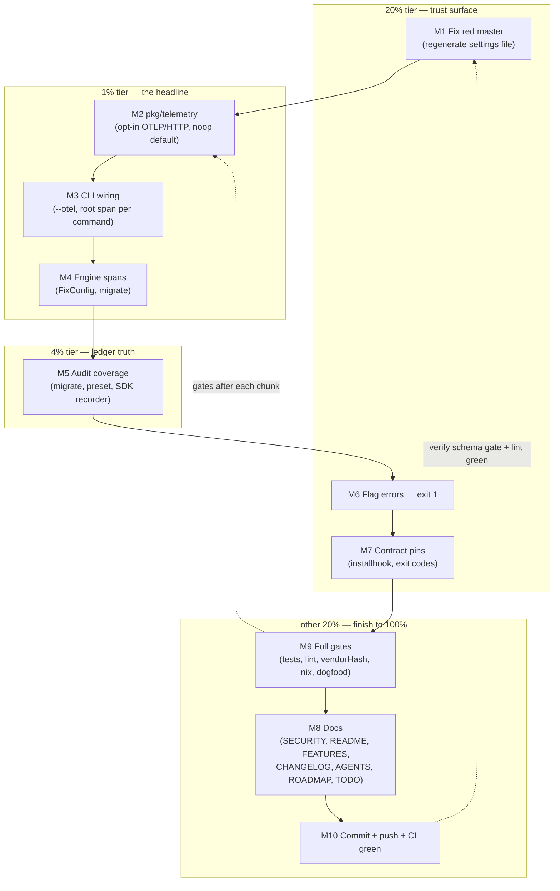

# SUPERB Plan: Optional OTEL Support + Audit Coverage + Master-Green

**Date:** 2026-11-02 00:29
**Trigger:** "Make everything superb! + We should support optional OTEL support."
**Source inputs:** 2026-11-02 audit session (invocations/CQRS-ES/OTEL) + its self-review
report (`docs/status/2026-11-02_00-18_audit-invocations-cqrs-otel-self-review.md`) +
live repo/CI verification during planning.

## Goal

1. **Optional OTEL support** — opt-in, off by default, zero egress unless explicitly
   enabled; traces with a root span per CLI command and spans at the engine seams.
   The SECURITY.md local-only posture stays true by default.
2. **Close the audit-coverage gaps** from the audit session: `migrate` and
   `configure --preset` mutations become ledger events; SDK/embedded consumers get a
   recorder injection point.
3. **Master green again** — the CI "Schema compat gate" job is red (stale
   generated settings file); fix first so everything else lands on a green base.
4. Small correctness/UX wins surfaced by the audit: flag errors exit 1 (Rejection),
   not 75; pin exit codes and the installhook no-mutation contract with specs.

## Errata (stale assumptions corrected during planning)

- **"75-vs-1 exit-code inconsistency" from the self-review is a FALSE ALARM.**
  Live verification: `configure --check --diff` (changes needed) exits **1** =
  `ErrChangesNeeded` → `Conflict` → 1 (`pkg/errors/classification.go:46`), correct and
  consistent. The observed 75 was the **unknown-flag** path (`--show-diff` typo →
  fang/cobra flag error falls into the unclassified default). Real (small) issue:
  usage errors exit 75 (EX_TEMPFAIL) instead of 1 — fixed via `SetFlagErrorFunc`.
- **Lint "drift" is version skew, not repo debt.** CI lint job on master is GREEN
  (pinned golangci-lint v2.14); the 61 wrapcheck findings appear only under local
  v2.15. Deliberate non-fix this session; documented in AGENTS.
- **TODO_LIST audit-coverage row (2026-11-02) is accurate and only PARTIALLY closes
  here**: migrate/preset/SDK coverage ship; run-lifecycle events stay open
  (USER-GATED noise/retention tradeoff).
- **Concurrent-session work in flight:** `pkg/migration/*.go` and three
  `docs/status/*` files are modified by another session. This plan does NOT touch
  `pkg/migration` files; all commits are pathspec-scoped to avoid capturing them.

## Pareto Breakdown

- **The 1% that delivers 51%:** Optional OTEL end-to-end (M2–M4): flag/env gate,
  noop default, OTLP/HTTP export, root span per command, engine spans, specs,
  SECURITY posture preserved. This is the headline user-facing feature.
- **The 4% that delivers 64%:** Audit-ledger truth (M5): migrate + preset events +
  SDK recorder injection. Makes "every mutation is an event" true for 4/4 paths.
- **The 20% that delivers 80%:** Master-green fix (M1) + flag-error exit code (M6)
  + contract pins (M7). Trust surface: CI red is a credibility hole; exit codes and
  no-mutation contracts are user-facing promises.
- **The other 20% to reach 100%:** Full verification gates (M9), all docs
  (M8: SECURITY/README/FEATURES/CHANGELOG/AGENTS/ROADMAP/TODO_LIST), curated
  commits + push + CI verification (M10).

## Master Plan (tasks of 30–100 min, sorted by importance/impact/effort/customer-value)

| #   | Task (30–100 min)                                                                                       | Tier | Impact | Effort | Customer value                                                                    |
| --- | ------------------------------------------------------------------------------------------------------- | ---- | ------ | ------ | --------------------------------------------------------------------------------- |
| M1  | Fix red master: regenerate `linter_settings_generated.go` per drift-guard command, verify schema gate     | 20%  | Critical (CI red) | S (30m) | Trust: green CI for every downstream user                    |
| M2  | `pkg/telemetry`: opt-in OTEL setup (env `GOLANGCI_LINT_AUTO_CONFIGURE_OTEL` / `--otel`), OTLP/HTTP exporter, resource, noop default, BDD specs incl. wire-level e2e (httptest OTLP receiver) | 1% | High | M (90m) | The headline: observable runs without default egress        |
| M3  | CLI wiring: `--otel` persistent flag, session lifecycle in `Execute` (setup in PersistentPreRun, finish+flush after fang), root span per command (recursive RunE wrap) | 1% | High | M (60m) | One flag turns on full-run tracing                          |
| M4  | Engine spans: `FixConfig` span + phase events + result attrs (changes, converged, dry-run); `migrate` span | 1%  | Medium | S (45m) | Useful spans, not just one blob                             |
| M5  | Audit coverage: `audit.EnvVarDisable` const, actions `config-migrated` + `preset-applied`, wire migrate + preset (non-dry-run only), `client.Options.Recorder` injection + specs | 4% | High | M (75m) | Truthful ledger on 4/4 mutating paths; SDK consumers can opt in |
| M6  | Flag errors → Rejection (exit 1) via `SetFlagErrorFunc` + spec                                            | 20%  | Medium | S (30m) | Correct usage-error semantics (75 → 1)                      |
| M7  | Contract pins: installhook never mutates `.golangci.yml` spec; ErrChangesNeeded exit-1 pin (only if unpinned) | 20% | Medium | S (30m) | Promises that can't silently rot                             |
| M8  | Docs: SECURITY.md (opt-in telemetry), README (OTEL section), FEATURES.md, CHANGELOG, AGENTS.md (telemetry gotcha + gotcha-17 caveat update + lint-skew note), ROADMAP (OTEL decision recorded), TODO_LIST (row partially closed) | rest | Medium | M (60m) | Honest, current docs                                        |
| M9  | Full gates: `ginkgo -r -p -race` full suite, golangci-lint on touched packages (vs master baseline), `scripts/vendorhash-guard.sh --fix`, `nix build`, dogfood `configure --check` | rest | High | M (60m) | "Superb" is measured, not claimed                            |
| M10 | Curated commits (pathspec-scoped, detailed messages), push, verify pushed CI run green                     | rest | High | S (30m) | Landed, published, verified                                   |

**Execution order:** M1 → M2 → M3 → M4 → M5 → M6 → M7 → M9(gates after each chunk, full at end) → M8 → M10.

## Fine Plan (tasks ≤ 12 min each, sorted by importance/impact/effort/customer-value)

| #    | Task (≤ 12 min)                                                                                        | Master | Tier |
| ---- | ------------------------------------------------------------------------------------------------------ | ------ | ---- |
| F1   | Run `go run ./cmd/generate-settings ... -schema-version=v2.14.0` to regenerate the stale file           | M1     | 20%  |
| F2   | Review regenerated diff (provenance header, formatting via gofmt) — no semantic surprises               | M1     | 20%  |
| F3   | Verify schema-fixture gate locally (`go run ./cmd/generate-schema-fixture` + `git diff --exit-code`); commit M1 with detailed message | M1 | 20% |
| F4   | `go get go.opentelemetry.io/otel@latest` + `otel/sdk` + `otel/exporters/otlp/otlptrace/otlptracehttp`; check `go 1.27` floor unchanged; tidy | M2 | 1% |
| F5   | `pkg/telemetry/telemetry.go`: `Options`, `Session`, enable gate (flag OR env const `EnvVarEnable`)       | M2     | 1%   |
| F6   | Setup: otlptracehttp exporter (reads standard OTEL_EXPORTER_OTLP_* env), batch processor, resource (service.name/version from pkg/version) | M2 | 1% |
| F7   | Finish: end root span w/ status + error family/code attrs, shutdown+flush with timeout ctx; setup failure → warn + noop (best-effort like audit ledger) | M2 | 1% |
| F8   | Spec: disabled (default) → noop tracer, no provider, no error, no egress                                 | M2     | 1%   |
| F9   | Spec: enabled + httptest OTLP receiver → Setup OK, span exported, server got protobuf POST, flush on Finish | M2 | 1% |
| F10  | `go mod tidy` + build + lint the new package (wrapcheck/errcheck on shutdown paths)                      | M2     | 1%   |
| F11  | `Flags.OTel` field + `--otel` persistent flag registration (help text: opt-in, default off)              | M3     | 1%   |
| F12  | `Execute`: create `Session`, pass into root command; `PersistentPreRun` does gated Setup (command name known there) | M3 | 1% |
| F13  | Recursive subcommand RunE wrap → root span `cli.<name>` for EVERY command incl. migrate/completion/installhook | M3 | 1% |
| F14  | Span finish in `Execute` after fang returns: record error family/code, changes-applied attr where available | M3 | 1% |
| F15  | CLI spec: `--help` lists `--otel`; default run makes no provider (unit-level assert via telemetry package) | M3 | 1% |
| F16  | `FixConfig` span via `otel.Tracer(module path)` + phase events (collect/normalize/plan/apply)            | M4     | 1%   |
| F17  | Result attrs: dry_run, priority, changes_total, converged; error → span status Error                     | M4     | 1%   |
| F18  | `migrate` span in cmd/migrate.go (fixes applied, dry-run attr)                                           | M4     | 1%   |
| F19  | Lint-clean pass over all new span code (wsl, wrapcheck)                                                  | M4     | 1%   |
| F20  | Export `audit.EnvVarDisable`; `internal/cli` auditEnvVar aliases it                                      | M5     | 4%   |
| F21  | Actions: `ActionConfigMigrated` ("config-migrated"), `ActionPresetApplied` ("preset-applied") in pkg/audit | M5   | 4%   |
| F22  | Wire ledger into migrate command (cmd/migrate.go): build via audit API, emit on non-dry success          | M5     | 4%   |
| F23  | Wire ledger into preset path (cmd_configure_preset.go): emit `preset-applied` on non-dry save            | M5     | 4%   |
| F24  | `client.Options.Recorder audit.Recorder` → `SetLedger` when non-nil + doc comment (cycle detection note)  | M5     | 4%   |
| F25  | Spec: migrate (non-dry) writes exactly one `config-migrated` entry; dry-run writes none                   | M5     | 4%   |
| F26  | Spec: preset run writes `preset-applied` with preset names; check-mode preset run writes none             | M5     | 4%   |
| F27  | Spec: client with Recorder emits entries on FixConfig apply                                              | M5     | 4%   |
| F28  | `rootCmd.SetFlagErrorFunc` → `errorfamily.WrapRejection` ("cli.flags") — usage errors exit 1             | M6     | 20%  |
| F29  | Spec: unknown flag exits 1 with family=rejection (was 75)                                                | M6     | 20%  |
| F30  | Spec: installhook writes only the git hook file, never `.golangci.yml`                                   | M7     | 20%  |
| F31  | Check `exit_code_test.go` for ErrChangesNeeded pin; add Conflict→1 pin if missing                        | M7     | 20%  |
| F32  | SECURITY.md: telemetry paragraph (strictly opt-in, standard OTEL envs, default local-only)               | M8     | rest |
| F33  | README.md: "Optional OpenTelemetry" section (flag, env, exporter envs, example)                          | M8     | rest |
| F34  | FEATURES.md: OTEL row (DONE), audit-coverage rows update                                                 | M8     | rest |
| F35  | CHANGELOG.md: Added (OTEL opt-in; migrate/preset audit; SDK recorder), Fixed (flag-error exit 1)         | M8     | rest |
| F36  | AGENTS.md: new telemetry gotcha (design: API-in-libs/SDK-at-CLI, gate, best-effort), update gotcha 17 caveat, lint-skew note | M8 | rest |
| F37  | ROADMAP.md: OTEL decision recorded (traces shipped; metrics/logs future); TODO_LIST: coverage row updated (3 sub-items done, lifecycle events open) | M8 | rest |
| F38  | Focused suites after each chunk: `go test ./pkg/telemetry/... ./internal/cli/... ./pkg/client/...`       | M9     | rest |
| F39  | Full gate: `ginkgo -r -p -race --skip-package=cmd/` + `go test ./cmd/...` (CGO_ENABLED=1)                | M9     | rest |
| F40  | golangci-lint on touched packages; diff vs master baseline = zero NEW findings                           | M9     | rest |
| F41  | `scripts/vendorhash-guard.sh --fix` after go.mod change; commit vendorHash.nix with it                   | M9     | rest |
| F42  | `nix build` (reproducible gate) + dogfood `configure --check` exit 0                                     | M9     | rest |
| F43  | `nix fmt` + templ untouched check; final `git status` review of MY files only                            | M9     | rest |
| F44  | Curated commit(s), pathspec-scoped, very detailed messages                                              | M10    | rest |
| F45  | `git push` (explicitly requested)                                                                       | M10    | rest |
| F46  | `gh run watch`/`list`: pushed commit's ci.yml green (incl. schema gate)                                  | M10    | rest |

## Execution Graph

## Design decisions (locked, anti-Verschlimmbesser)

1. **OTEL API in reusable packages, SDK only at the CLI boundary** (how-to-golang:
   libraries never force a telemetry dependency). `pkg/linter` / `internal/cli` may
   call `otel.Tracer(...)` (API, noop default); ONLY `pkg/telemetry` (consumed by
   the CLI) imports the SDK + OTLP exporter. SDK consumers (BuildFlow) get noop
   tracers unless the host registers a provider — zero behavior change.
2. **Opt-in gate:** `--otel` flag OR `GOLANGCI_LINT_AUTO_CONFIGURE_OTEL=1` env.
   Standard `OTEL_EXPORTER_OTLP_*` envs configure the endpoint. Default: noop
   tracer, zero egress — SECURITY.md posture preserved.
3. **Best-effort telemetry** (same philosophy as the audit ledger): setup or export
   failure logs a warning and degrades to noop; a run never fails because tracing
   could not be initialized.
4. **Traces only** in this iteration; metrics/logs are a documented ROADMAP idea.
5. **No `pkg/migration` file edits** (concurrent session owns them right now);
   migrate ledger wiring lives in `internal/cli/cmd/migrate.go`.
6. **Exit codes:** only the flag-error path changes (75→1). ErrChangesNeeded→1
   stays as-is (already correct + potentially pinned by existing specs).
7. **CI lint version stays pinned at v2.14** (green); local v2.15 wrapcheck noise
   is documented in AGENTS as version skew, not repo debt.

## Verification gates (definition of done)

- [ ] ci.yml green on the pushed commit (schema gate included)
- [ ] Full `ginkgo -r -p -race` suite green; zero new lint findings vs master
- [ ] `nix build` succeeds; vendorHash.nix committed in sync with go.mod
- [ ] Default run: no tracer provider, no egress (spec-pinned)
- [ ] `--otel` + local OTLP receiver: root span + engine span received (spec-pinned)
- [ ] migrate + preset runs write ledger entries; dry runs write none (spec-pinned)
- [ ] SDK client with injected Recorder writes entries (spec-pinned)
- [ ] Unknown flag exits 1 with family=rejection (spec-pinned)
- [ ] Dogfood `configure --check` exit 0 on this repo's own config
