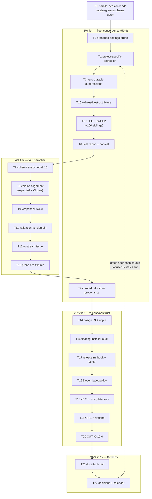

# SUPERB Plan: Fleet Convergence Pass + v2.15 Frontier + Release/Ops Trust

**Date:** 2026-11-02 03:11
**Trigger:** "Let's figure out what we should really do! 20%/4%/1% breakdown + comprehensive plan + micro breakdown + mermaid graph + commit & push."
**Source inputs:** `TODO_LIST.md` (2026-11-02 fifth-sweep edition, 18 open rows — every row re-verified against the tree during the sweep), the 2026-11-02 upstream-v2-audit report's f-section (`docs/status/2026-11-02_00-03…md`), the 2026-10-17 release/incident reports' harvested rows, and the fifth-sweep session's own fallout (`docs/status/2026-11-02_01-19…md` §f).

**Concurrent-session boundary:** the 00:29 OTEL/audit-coverage plan (M1–M10: red-master schema-gate fix, `pkg/telemetry`, audit-ledger coverage, flag-error exit codes, its own docs+gates+push) is IN FLIGHT right now (`pkg/telemetry/`, `internal/cli/*`, `pkg/migration/*` dirty in the tree). This plan does **not** touch those files or re-dispatch that work; execution order below starts after their master-green fix lands (dependency D0).

## Goal in one sentence

Turn the accumulated tool correctness (v0.11.0 reconciler, always-0 caps, run.go healing, corrected supersession chains, v2.15 compat) into **fleet-wide delivered value** — one convergence pass over ~160 sibling projects — while closing the v2.15 version frontier and the release/ops trust cluster, then cutting v0.12.0.

## Errata (stale assumptions corrected during planning)

- "TODO row: delete legacy engine / delete compat views" — already shipped in v0.11.0 (verified during the fifth sweep); not re-planned here.
- "Root-cause lll drop" — closed by the 2026-10-17 `mergeNormalizerChanges` union fix; not re-planned.
- The 00:29 plan's errata already falsified the "75-vs-1 exit code" alarm; not re-planned.
- `ExpectedGolangCILintVersion` re-check (my TODO row) and the 00-03 report's "bump to v2.15" are the SAME task — merged here as T8.

## Pareto Breakdown

- **The 1% that delivers 51% — The Fleet Convergence Pass (T1–T6):** three small tool changes that change what one sweep WRITES (stale project-specific linter retraction, orphaned-settings prune for `default: standard`, auto-durable suppression offers), then ONE configure pass across ~160 siblings heals everything measurable: 148 patch-form `run.go` values, ~128 legacy issue caps → 0, 109 deprecated `exhaustruct` exclusion entries, 21 outright-broken configs, plus the corrected deadcode/varcheck/structcheck/exhaustivestruct migrations and stale arangolint/clickhouselint retraction (fleet impact scan dimension from the 00-03 report folded in). This is the tool's entire reason to exist at fleet scale — nothing else in the backlog touches this many projects.
- **The 4% that delivers 64% — + the v2.15 version frontier (T7–T13):** schema snapshot v2.15, `ExpectedGolangCILintVersion` + coordinated CI pin bump, wrapcheck-skew resolution, parity fixture, upstream issue (verified first). Keeps the tool truthful against the CURRENT upstream; hard prerequisite for an honest v0.12.0.
- **The 20% that delivers 80% — + the release/ops trust cluster (T14–T20):** cosign v3 migration + unpin, v0.11.0 artifact completeness (signatures/SBOMs/GHCR smoke — USER-GATED), floating-installer + action-SHA audit, release-process runbook fold-in, GHCR hygiene, Dependabot vendorHash policy, and the v0.12.0 cut that ships all of it.
- **The other 20% to reach 100% (T21–T22):** docs/truth tail (markdownlint nested-config investigation, FEATURES full re-audit earning the 2026-11-02 stamp, README version-claims check, cosmetic table padding), plus the gated decisions and calendar items (buildflow posture, M32 ratification, AGENTS size posture, declined-verdict owner review, KnownBadSettingsKeys upstream-deprecation policy, erraudit ~2027-01, flake check output, skill-tooling upstream fix).

## Master Plan — Comprehensive (tasks of 30–100 min, sorted by importance/impact/effort/customer-value)

| #   | Task (30–100 min)                                                                                                                             | Tier | Impact | Effort | Customer value |
| --- | --------------------------------------------------------------------------------------------------------------------------------------------- | ---- | ------ | ------ | -------------- |
| T1  | **Stale project-specific linter retraction**: removal pass when the tech dep disappears (arangolint/clickhouselint in configs without the dep), audit entry, respecting sidecar/`never-enable` + specs | 1%   | High — 123+120 stale entries across the fleet | M (60m) | Configs stop carrying linters that can never fire; lint surface shrinks |
| T2  | **Orphaned-settings prune for `default: standard`**: extend `PruneOrphanSettings` condition to "not in enable ∪ disable ∪ effective default set" + specs | 1%   | Medium — 10 configs carry dead settings | S (30m) | Configs stop carrying dead weight (funcorder/exhaustruct settings) |
| T3  | **Auto-durable suppressions**: when ledger cycle detection suppresses a re-enable, offer/emit the `never-enable` sidecar entry (0/157 sidecars today) | 1%   | Medium — cross-machine durability of a per-machine signal | M (60m) | Hand-removed linters stay removed on every machine |
| T4  | **Curated-default refresh with provenance**: hash-stamp tool-owned settings blocks; refresh only when a block still equals an older curated default + specs | 1%   | Medium — 144/136/22 configs carry stale curated blocks | L (100m) | Evolving defaults reach existing configs without nuking user tuning |
| T5  | **Fleet convergence sweep**: run `configure` across ~160 siblings (cross-repo memo 2026-10-07 standing auth; execution stays user-triggered), collect per-repo diffs + ledger stats; fold in the 00-03 fleet impact scan (grep deadcode/varcheck/structcheck/exhaustivestruct/interfacer/nosnakecase) | 1%   | **Critical** — the single highest-value item in the backlog | M (90m) | 148 run.go heals, ~128 cap convergences, 109 deprecation sweeps, 21 broken configs fixed, stale retractions land |
| T6  | **Fleet convergence report** → status report + TODO/CHANGELOG/FEATURES harvest + audit-ledger cross-repo story | 1%   | High — visibility | S (30m) | The fleet value is measured and recorded |
| T7  | **Schema snapshot v2.15.0**: capture schema, regenerate `linter_settings_generated.go`, update CI `-schema-version=v2.15.0` in the same commit | 4%   | High — reference truth + drift guard | M (45m) | Tool data matches current upstream |
| T8  | **Version-frontier alignment**: decide + bump `ExpectedGolangCILintVersion` v2.14.0 → v2.15.0; coordinated CI pin bump (lint + test jobs); README version-claims check | 4%   | High | S (45m) | Recommended-version claim is truthful; CI exercises v2.15 |
| T9  | **wrapcheck-on-v2.15 skew resolution**: either add `errorfamily` constructors to own wrapcheck ignore-sigs or document the v2.14 lint pin as deliberate (record in TODO/AGENTS) | 4%   | Medium — 61 local findings are version skew, not debt | S (30m) | Local lint runs stop misleading |
| T10 | **exhaustivestruct parity-corpus fixture**: byte-level pin of the chain collapse through the full FixConfig pipeline | 4%   | Medium | S (30m) | The corrected migration can never silently regress |
| T11 | **Single-criterion validation version pin**: identify WHICH upstream v2 version rejects single-criterion exclusion rules; record in CHANGELOG | 4%   | Low-Medium | S (30m) | The compat claim becomes precise |
| T12 | **Upstream v2.15 issue (verify → file)**: bare-dir `linters` lists all linters under Enabled; verify against source, file with the github-voice + verify-before-filing skills | 4%   | Medium — ecosystem fix | S (45m) | The probe-poisoning class dies upstream |
| T13 | **Probe era fixtures**: commit v2.14-style + v2.15-style `linters --json` fixtures as explicit testdata for the probe guard | 4%   | Medium | S (30m) | Probe guard pinned against both binary eras |
| T14 | **cosign v3 signs migration + unpin**: migrate GoReleaser signs config to the v3 bundle format, unpin `cosign-release` v2.6.5, prove with a snapshot | 20%  | High — current signing stack | M (75m) | Future releases sign with supported tooling |
| T15 | **v0.11.0 artifact completeness** (USER-GATED): backfill cosign signatures + SBOMs for the 12 assets, smoke-test the workflow-backfilled GHCR image | 20%  | Medium-High — sigstore-verifying consumers get nothing today | M (60m) | v0.11.0 becomes fully verifiable |
| T16 | **Floating-installer + action-SHA audit**: sweep `.github/workflows/*.yml` for "latest"-resolving installers (the cosign-v3 class); add action-SHA bump automation decision | 20%  | Medium-High — same silent-breakage class | M (60m) | Release pipeline can't be broken by upstream majors |
| T17 | **Release-process runbook fold-in**: tag-failed-after-push runbook into `release-process.md`; extend `post-release-verify.sh` (signatures, SBOM assets, cask version, GHCR tag) | 20%  | Medium | S (45m) | The next failed release doesn't re-derive the runbook |
| T18 | **GHCR hygiene**: delete stray `:master` tag (`delete:packages` — USER-GATED scope), smoke-test backfill-image on a fresh tag | 20%  | Low-Medium | S (30m) | Container story is clean |
| T19 | **Dependabot × vendorHash policy**: decide + implement (auto-commit on `dependabot/**`, `continue-on-error`, or rebase bot); confirm a green scheduled run | 20%  | Medium — every go_modules PR is red today | S (45m) | Dependency PRs become mergeable |
| T20 | **Cut v0.12.0**: CHANGELOG, pre-release checklist, tag, watch pipeline, post-release verify, curated release notes (ships: corrected supersession chains, v2.15 compat, fleet-tool changes, cosign v3) | 20%  | High — the delivery moment | M (90m) | Users get everything above |
| T21 | **Docs/truth tail**: markdownlint nested-object config investigation; FEATURES full re-audit (earn the 2026-11-02 stamp); restore going-public b/c table padding (cosmetic) | rest | Medium | M (75m) | Docs stop overclaiming |
| T22 | **Gated decisions + calendar staging**: buildflow findings-gate posture, M32 never-enable ratification, AGENTS.md size posture, declined-verdict owner review (grep path provided), KnownBadSettingsKeys upstream-deprecation policy, flake.nix golangci-lint check output, skill-tooling check-rows encoding fix (upstream), erraudit ~2027-01 calendar note | rest | Medium (unblocks rows) | S (30m) | Every USER-GATED row has a crisp decision packet |

**Execution order:** D0 (parallel session lands master-green) → T2 → T1 → T3 → T10 → T5 → T6 → T7 → T8 → T9 → T11 → T12 → T13 → T4 → T14 → T16 → T17 → T19 → T15 → T18 → T20 → T21 → T22. (Cheap tool-hardening before the sweep; version frontier before the release; decisions staged anytime.)

## Fine Plan — Detailed Breakdown (tasks ≤ 12 min each, sorted by importance/impact/effort/customer-value)

| #   | Task (≤ 12 min) | Master | Tier |
| --- | --------------- | ------ | ---- |
| F1  | Grep `ProjectSpecificLinters` consumers; write failing spec: arango dep gone → next configure removes entry | T1 | 1% |
| F2  | Implement retraction normalizer (Change + `retracted-project-specific` audit action), respecting sidecar/never-enable | T1 | 1% |
| F3  | Specs: dep present → kept; sidecar never-enable → kept + audited; dry-run → planned only | T1 | 1% |
| F4  | Write failing spec: orphaned settings under `default: standard` survive today | T2 | 1% |
| F5  | Extend `PruneOrphanSettings` condition to include the effective default set; keep `default: none` behavior byte-identical | T2 | 1% |
| F6  | Regression spec: enabled/disabled linters' settings untouched in both default modes | T2 | 1% |
| F7  | Design the suppression→sidecar offer surface (log line + docs vs interactive prompt — decide: non-interactive warning + example block, CLI stays scriptable) | T3 | 1% |
| F8  | Implement: on `ActionSuppressedReEnable`, emit warning with a copy-paste `never-enable:` sidecar block | T3 | 1% |
| F9  | Spec: suppression path prints the block exactly once; no sidecar file is auto-written | T3 | 1% |
| F10 | Docs: README never-enable section gains the "durable suppression" note | T3 | 1% |
| F11 | Design provenance stamp: hash of the curated block at injection time (comment marker vs sidecar — pick comment marker `# managed-by:`) | T4 | 1% |
| F12 | Implement stamp write at injection + comparison helper (block == an older curated default?) | T4 | 1% |
| F13 | Refresh pass: stamp-matched blocks update to current curated; user-diverged blocks untouched + audited `refreshed-managed-settings` | T4 | 1% |
| F14 | Specs: stamp round-trip, user-tuning preservation, `--force-settings` still wins | T4 | 1% |
| F15 | CHANGELOG + AGENTS gotcha for managed-settings provenance | T4 | 1% |
| F16 | Fleet pre-scan script: per-repo `configure --check --dry-run` → bucket counts (run.go / caps / deprecations / retraction / prune / refresh) | T5 | 1% |
| F17 | Run pre-scan across `~/projects/*`; record the expectation table | T5 | 1% |
| F18 | Execute sweep batch 1 (20 repos): configure, verify diff per repo, commit per cross-repo memo protocol | T5 | 1% |
| F19 | Execute sweep batch 2 (40 repos) | T5 | 1% |
| F20 | Execute sweep batch 3 (40 repos) | T5 | 1% |
| F21 | Execute sweep batch 4 (remaining repos + skip-list with reasons) | T5 | 1% |
| F22 | Fold in 00-03 f9 scan: grep configs for deadcode/varcheck/structcheck/exhaustivestruct/interfacer/nosnakecase; report behavior-change count | T5 | 1% |
| F23 | Write fleet convergence status report (per-bucket totals, scars, skip list) | T6 | 1% |
| F24 | Harvest report into TODO/CHANGELOG/FEATURES; update fleet-audit numbers in TODO rows | T6 | 1% |
| F25 | Cross-repo audit-ledger story note (which repos recorded what) | T6 | 1% |
| F26 | Capture v2.15.0 `jsonschema/golangci.jsonschema.json` into `pkg/constants/schema/` | T7 | 4% |
| F27 | Regenerate `linter_settings_generated.go` with `-schema-version=v2.15.0`; review diff | T7 | 4% |
| F28 | Update CI schema-verify regen command to v2.15.0 in the same commit; local drift-guard green | T7 | 4% |
| F29 | Check MinGolangCILintVersion derivation still holds (new keys vs v2.12.0 floor; bump floor if a new curated key demands it) | T7 | 4% |
| F30 | Decide + bump `ExpectedGolangCILintVersion` → v2.15.0 (spec updates) | T8 | 4% |
| F31 | Coordinated CI pin bump: lint + test job golangci-lint versions | T8 | 4% |
| F32 | README requirements/claims sweep for version names | T8 | 4% |
| F33 | Reproduce wrapcheck v2.15 findings; decide ignore-sigs vs pin-doc (prefer: document pin; ignore-sigs only if findings are ours) | T9 | 4% |
| F34 | Record the skew decision in AGENTS + TODO (deliberate non-fix or fixed) | T9 | 4% |
| F35 | Add exhaustivestruct chain fixture to the parity corpus (config → expected bytes through FixConfig) | T10 | 4% |
| F36 | Wire fixture into `TestParityCorpusConverge`; verify green | T10 | 4% |
| F37 | Bisect/grep upstream for the single-criterion validation version; record in CHANGELOG Unreleased | T11 | 4% |
| F38 | Spec update: emptied-rule drop note names the version | T11 | 4% |
| F39 | Verify the v2.15 bare-dir behavior against upstream source (verify-before-filing) | T12 | 4% |
| F40 | Draft + file the upstream issue (github-voice skill); link from AGENTS gotcha 8 | T12 | 4% |
| F41 | Commit v2.14-style + v2.15-style `linters --json` probe fixtures as testdata; parameterize the guard spec | T13 | 4% |
| F42 | Migrate `.goreleaser.yaml` signs block to cosign v3 bundle format (docs-driven) | T14 | 20% |
| F43 | Unpin `cosign-release` in release.yml; `goreleaser check` + snapshot sign run locally | T14 | 20% |
| F44 | Spec/gate: release-dry-run job exercises the sign step | T14 | 20% |
| F45 | CHANGELOG + release-process.md note (v3 bundle, unpin) | T14 | 20% |
| F46 | Backfill: `nix run nixpkgs#cosign` sign-blob the 12 v0.11.0 assets; upload .sig/.pem | T15 | 20% |
| F47 | Backfill: `syft` SBOMs for the archives; upload | T15 | 20% |
| F48 | Amend v0.11.0 release notes with the completeness caveat/upgrade note | T15 | 20% |
| F49 | Smoke: pull `:v0.11.0` GHCR image, run `--version` | T15 | 20% |
| F50 | Inventory every workflow step that resolves "latest" (installers, `nix run nixpkgs#`, `@vN` actions) | T16 | 20% |
| F51 | Pin the installers found; add pinned-version table to a runbook section | T16 | 20% |
| F52 | Decide action-SHA bump automation (dependabot custom manager vs manual); implement or record decision | T16 | 20% |
| F53 | Release-process.md: fold in the tag-failed runbook (local fallback, GORELEASER_CURRENT_TAG, backfill dispatch, TMPDIR) | T17 | 20% |
| F54 | Extend `post-release-verify.sh`: signatures present, SBOM assets, cask version, GHCR tag exists | T17 | 20% |
| F55 | Dry-run the extended script against v0.11.0 (expected: lists the known gaps) | T17 | 20% |
| F56 | GHCR: attempt `:master` tag deletion with available scope; else document the USER-GATED block precisely | T18 | 20% |
| F57 | GHCR: dispatch backfill-image on a throwaway tag; verify image + cleanup | T18 | 20% |
| F58 | Dependabot: pick policy (prefer `continue-on-error` on the guard step for dependabot actors + guard note) | T19 | 20% |
| F59 | Implement + watch one scheduled run green; prune/annotate the TODO row | T19 | 20% |
| F60 | v0.12.0 prep: CHANGELOG Unreleased → versioned section; FEATURES stamp; TODO prune | T20 | 20% |
| F61 | Run `scripts/pre-release-check.sh` (TMPDIR-safe); clear findings | T20 | 20% |
| F62 | Full gates: `ginkgo -r -p -race`, lint, `nix build`, dogfood `configure --check`, vendorhash guard | T20 | 20% |
| F63 | Tag + push + watch release pipeline; curated notes via `gh release edit` | T20 | 20% |
| F64 | Post-release verify (extended script) + clean `go get` proxy check + TODO/CHANGELOG close-out | T20 | 20% |
| F65 | markdownlint nested-config: isolate with a minimal jsonc fixture; test boolean vs object keys under `npx markdownlint-cli2` | T21 | rest |
| F66 | markdownlint: fix config shape or file upstream issue with the repro | T21 | rest |
| F67 | FEATURES full re-audit: verify every row against code (spot-check commands per section); correct drift | T21 | rest |
| F68 | Restore going-public b/c table padding (cosmetic, archive file) | T21 | rest |
| F69 | Decision packet: buildflow findings-gate posture (options + recommendation, 5-min read) | T22 | rest |
| F70 | Decision packet: M32 never-enable replacement ratification | T22 | rest |
| F71 | Decision packet: AGENTS.md size posture (prune vs keep; cost estimate) | T22 | rest |
| F72 | Owner review path: run `grep -rE "declined" docs/archive/status/2026-0*.md`, list veto candidates | T22 | rest |
| F73 | Decision packet: KnownBadSettingsKeys scope (own bad keys only vs upstream-soft-deprecated `ignore-strings` class) | T22 | rest |
| F74 | Implement flake.nix `golangci-lint run` check output | T22 | rest |
| F75 | Upstream: fix check-rows subprocess capture (UnicodeDecodeError) in the docs-health skill tooling | T22 | rest |
| F76 | Calendar: erraudit quarterly re-check note (~2027-01) verified present in TODO | T22 | rest |

## Execution Graph

## Design decisions (locked, anti-Verschlimmbesser)

1. **Tool changes BEFORE the sweep** (T1–T4 precede T5): every sibling healed once, not twice.
2. **Fleet execution stays user-triggered** per the cross-repo authorization memo (2026-10-07): the plan stages it; the trigger is yours.
3. **No `pkg/telemetry`/`internal/cli`/`pkg/migration` edits** while the parallel session is in flight; v0.12.0 (T20) sequenced after their landing.
4. **Retraction and prune are audited Changes** (ADR-017 audit=diff), never silent deletions; sidecar/never-enable always win.
5. **Version bumps are coordinated**: schema snapshot + expected version + CI pins + README in one commit each — no split-brain windows.
6. **Every USER-GATED row gets a decision packet, not a default**: buildflow posture, M32, artifact completeness, GHCR scope, KnownBadSettings scope, AGENTS size.
7. **The sweep respects the skip-list discipline**: repos with in-flight parallel work (like this repo's siblings with dirty trees) are skipped with reasons, per the cross-repo memo protocol.

## Verification gates (definition of done)

- [ ] Fleet report: per-bucket before/after counts; every touched sibling `config verify`-green
- [ ] Retraction/prune/refresh/suppression specs green; dry-runs plan-only
- [ ] Schema drift guard green with `-schema-version=v2.15.0`; MinGolangCILintVersion derivation re-checked
- [ ] Coordinated version bump: one commit, specs + CI + README aligned
- [ ] cosign v3 snapshot-sign run green locally; release-dry-run exercises it
- [ ] v0.11.0 assets verifiable (cosign verify-blob green) or the gate decision recorded
- [ ] v0.12.0: full gates green, curated notes, post-release-verify (extended) green, clean `go get`
- [ ] Living docs truthful: FEATURES stamp earned by row-level verification, not assertion
